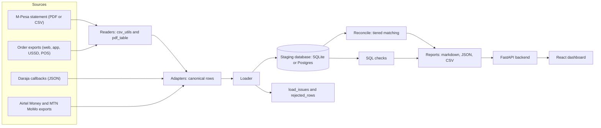

# payrecon-ea

[](https://github.com/waren23greg-stack/payrecon-ea/actions/workflows/ci.yml)

Reconciliation and data-quality checks for East African payment data: mobile-money
statements (M-Pesa first) matched against order exports, with every anomaly traceable
to a source row.

> **Status: work in progress.** Phases 0 and 1 (the core library) are done and tested.
> Phase 2 (the pipeline) is under way. This README is also the project map: section 8 is the
> full roadmap, and section 1 tells you how to find your place in it.

## Contents

1. [Where am I](#1-where-am-i)
2. [Why it exists](#2-why-it-exists)
3. [Architecture](#3-architecture)
4. [Repository map](#4-repository-map)
5. [Key decisions](#5-key-decisions)
6. [Reconciliation design](#6-reconciliation-design)
7. [Planned data-quality checks](#7-planned-data-quality-checks)
8. [Roadmap](#8-roadmap)
9. [Input and provider status](#9-input-and-provider-status)
10. [How we build](#10-how-we-build)
11. [Privacy and data handling](#11-privacy-and-data-handling)
12. [Limitations](#12-limitations)
13. [Glossary](#13-glossary)
14. [Licence](#14-licence)

## 1. Where am I

Lost? Run this from the project folder, then find the first unchecked session in
[section 8](#8-roadmap). That is the next piece of work.

```bash
cd ~/projects/payrecon-ea             # your clone; adjust the path
source .venv/Scripts/activate         # macOS and Linux: source .venv/bin/activate
git status --short                    # empty means nothing is half-done
git log --format='%h %s' | head -n 5  # the last sessions, newest first
python -m pytest                      # must be green before starting anything new
```

Rules of thumb:

- If `git status` is not empty, finish or discard that work first.
- If `pytest` is red, fix that before building anything new.
- Every session ends with a commit, so the log is a reliable history of what is done.

## 2. Why it exists

Mobile-money data is messy in ways generic ETL examples ignore. This project is built
around what real statements contain:

- One receipt number can appear on several lines (a payment, its fee and an overdraft
  draw), so a receipt is **not** a unique key. Lines are keyed by
  `(provider, receipt_no, kind, direction)`.
- Overdraft draws (for example Fuliza) are credit, not customer money, and must never
  be counted as income.
- Phone numbers arrive masked (`254798***048`) and amounts in several number formats.
- Statements are often password-protected PDFs rather than CSV files.
- A statement's own summary can disagree with its detail lines, so control totals are
  worth checking.
- Failed or odd rows are reported, never silently dropped.

The target is a pipeline an East African merchant could clone and run: integer minor
units, per-country time zones, Paybill and Till payments, and honest reporting.

## 3. Architecture



| Layer | Modules | Rule |
|---|---|---|
| Contract | `schema.py` | One source of truth for columns, enums, currencies, countries |
| Cleaning | `normalize.py` | Pure functions; blank input is a gap, bad input is a coded error |
| Reading | `csv_utils.py`, `pdf_table.py` | Bytes to text rows; report what was decided |
| Adapting | `adapters/` | Provider rows to canonical dicts; issues and rejects reported separately |
| Storage | `db.py`, `loader.py`, `sql/` | Permissive staging; one database per run |
| Analysis | `reconcile.py`, `checks.py`, `sql/checks/` | Matching in Python, rules as standalone SQL files |
| Output | `report.py`, `run.py`, API, UI | Auditable artifacts first, screens second |

## 4. Repository map

Status markers: **[done]**, **[next]**, **[planned]**.

```text
payrecon-ea/
  pyproject.toml                    packaging; extras: api, postgres, analytics, pdf, dev
  README.md                         this map
  LICENSE
  .github/workflows/ci.yml          tests on Linux (3.11 to 3.13) and Windows (3.12)
  data/                             synthetic datasets only; data/private/ is git-ignored
  docs/                             design notes, SOP, case study                 [planned]
  scripts/                          generate_sample_data.py and helpers           [next]
  sql/
    schema.sqlite.sql               GENERATED: python -m payrecon.db ddl sqlite
    schema.postgres.sql             GENERATED: python -m payrecon.db ddl postgres
    checks/                         one .sql file per data-quality check          [planned]
  src/payrecon/
    schema.py                       [done]  column contract, currencies, countries, enums, line key
    normalize.py                    [done]  money, phone, hint, timestamp, id, status parsing
    csv_utils.py                    [done]  bytes to rows: encoding, delimiter, header detection
    pdf_table.py                    [done]  statement PDF to rows (needs the pdf extra)
    adapters/
      base.py                       [done]  Issue, Rejected, AdaptedPayments
      mpesa_statement.py            [done]  statement rows to canonical payment lines
      orders.py                     [done]     order exports to canonical orders
      daraja.py                     [planned]  Daraja C2B callbacks to canonical payments
      airtel_mtn.py                 [planned]  Airtel Money and MTN MoMo exports
    db.py                           [done]  DDL generator, connections, one database per run
    loader.py                       [done]  adapter output to database, one transaction per file
    reconcile.py                    [planned]  tiered matching
    checks.py                       [planned]  runs sql/checks/*.sql
    report.py                       [planned]  markdown, JSON and CSV outputs
    run.py                          [planned]  command line entry point
    api/                            [planned]  FastAPI backend (api extra)
  frontend/                         [planned]  React, Vite and Tailwind dashboard
  tests/                            one test module per source module; synthetic data only
```

## 5. Key decisions

| Decision | Why | Where it lives |
|---|---|---|
| Money is integer minor units, with a per-currency exponent | Floats drift; UGX and RWF have no decimals | `schema.py`, `normalize.parse_money` (rejects finer than a minor unit, never rounds) |
| Fixed UTC offset per country, stored as UTC | East Africa has no DST; Rwanda is UTC+2; no tzdata dependency | `schema.COUNTRIES`, `normalize.parse_timestamp` |
| A receipt is not a unique key | One receipt can carry a payment, a fee and a draw | `schema.PAYMENT_KEY` |
| Overdraft draws are not customer money | They inflate "paid in" | `adapters/mpesa_statement.classify`, kind `OVERDRAFT_DRAW` |
| Free-text names are discarded | Third-party personal data | `adapters/mpesa_statement.py` and its tests |
| Phones: keyed hash plus masked hint | No raw numbers; hints let matching work when only masked numbers exist | `normalize.hash_phone`, `phone_hint`, `hints_compatible` |
| Errors are coded values | The loader records them and keeps the row | `NormalizationError`, `CsvError`, `Issue` |
| Staging is permissive | The checks must be able to see dirty rows | `db.render_ddl`, `tests/test_db.py` |
| One database per run | No SQLite write-lock clashes; easy purge | `db.new_run_db` |
| DDL is generated from `schema.py` | Single source of truth; committed files are tested for drift | `db.py`, `tests/test_db.py` |
| Core is standard library only; extras are optional | A clone runs with no setup | `pyproject.toml` |
| Failed rows are never silently dropped | Auditability | `adapters/base.py`: issues versus rejected |

## 6. Reconciliation design

Planned for session S7. The matching signal depends on how the customer paid.

| Merchant type | What the customer enters | Strongest signal |
|---|---|---|
| Paybill | Business number and an account number | The bill reference (tier 1, then tier 2) |
| Till (Buy Goods) | Till number and an amount only, no account field | Phone hint, amount and time window (tier 3) |
| STK push | Confirms a prompt on the phone | Request identifiers from the API if available, otherwise tier 3 |

Tiers, applied in order:

1. **Exact:** normalized bill reference equals the order reference.
2. **Fuzzy:** near matches such as O versus 0 or transposed digits, flagged for review.
3. **Contextual:** compatible phone hint, equal amount and a payment time inside a window
   after the order.

Outcomes: matched, amount mismatch (under or over, beyond a tolerance), orphan payment,
unpaid order, duplicate payment. Overdraft draws, charges and reversals are never counted
as customer money.

## 7. Planned data-quality checks

Names may change. Each check becomes one standalone `.sql` file with a metadata header.

| Category | Checks |
|---|---|
| Uniqueness | `duplicate_order_id`, `duplicate_line_key`, `duplicate_payment_per_order` |
| Completeness | `missing_customer_id`, `missing_order_date`, `missing_amount`, `missing_paid_ts`, `missing_receipt` |
| Validity | `unparseable_order_date`, `unparseable_paid_ts`, `non_positive_amount`, `invalid_status`, `invalid_phone`, `currency_mismatch`, `future_order_date` |
| Consistency | `amount_mismatch`, `orphan_payment`, `payment_before_order`, `reversal_without_original`, `unresolved_bill_ref`, `unexpected_direction` |
| Timeliness | `stale_data`, `late_payment` |
| Control totals | `control_total_mismatch`, `summary_does_not_foot` |

## 8. Roadmap

One session builds one module together with its tests, then ends with a commit. Tick a
box only when the session's "done when" is true.

### Phase 0: foundation

- [x] **S0** Repo scaffold, packaging, `.gitignore`, smoke test.

### Phase 1: core library

| Done | Session | Deliverable | Depends on | Done when |
|---|---|---|---|---|
| [x] | S1 | `schema.py`: currencies, countries, providers, column contract | S0 | Contract tests pass |
| [x] | S2 | `normalize.py`: money, phone, timestamp, reference, status | S1 | Edge-case tables pass |
| [x] | S3 | `csv_utils.py`: encoding, delimiter, header detection | S0 | Statement with title lines parses |
| [x] | S4a | Schema v2: line kinds, direction, phone hint, line key | S1 | Privacy guard test passes |
| [x] | S4b | `pdf_table.py` and a synthetic PDF generator for tests | S3 | Real statement totals match its own summary |
| [x] | S4c | Hint helpers, `adapters/base.py`, `adapters/mpesa_statement.py` | S2, S3, S4b | Real statement: no rejects, unique line keys |
| [x] | S5a | `db.py` and generated DDL for SQLite and Postgres | S1, S4a | Contract and drift tests pass |

### Phase 2: pipeline

| Done | Session | Deliverable | Depends on | Done when |
|---|---|---|---|---|
| [x] | S5b | `loader.py`: one transaction per file; writes files, rows, issues, rejects, statement summary; idempotent by file hash | S5a, S4c | Loading a file twice is refused; counts reconcile |
| [x] | S5c | `adapters/orders.py`: web, app, USSD and POS exports to canonical orders | S2, S3 | Orders load with references and EAT timestamps |
| [ ] | S6 | `scripts/generate_sample_data.py`: dirty and clean datasets with ground truth (Paybill, Till, Fuliza lines, duplicates, reversals, masked phones, reference typos) | S4c, S5c | Clean data has zero findings; every injected anomaly is in the ground truth |
| [ ] | S7 | `reconcile.py`: tiered matching (section 6) | S5b, S6 | Classification equals the ground truth |
| [ ] | S8 | `checks.py` runner and `sql/checks/*.sql`, in batches by category | S5b, S6 | Each check fails on its anomaly and passes on clean data |
| [ ] | S9 | `report.py`: markdown, JSON and CSV outputs including control totals | S7, S8 | Reports are reproducible from a run |
| [ ] | S10 | `run.py`: one command from files in to report out | S9 | End to end on the sample data |
| [ ] | S10b | `adapters/daraja.py`: C2B callbacks | S10 | Needs real or sandbox payloads; field names verified |
| [ ] | S10c | Airtel Money and MTN MoMo adapters | S10 | Needs real exports |
| [ ] | S10d | `adapters/sms.py`: M-Pesa SMS notifications, a common source for small shops (optional) | S10 | Needs masked sample messages; two-digit years and 12-hour times parse |

### Phase 3: quality

| Done | Session | Deliverable | Depends on | Done when |
|---|---|---|---|---|
| [ ] | S11 | End-to-end tests against ground truth | S10 | Zero false positives on clean data |
| [ ] | S12 | Cleanup pass 1: dead code, doc drift, lint configuration | S11 | Backlog in section 10 is empty |

### Phase 4: full stack

| Done | Session | Deliverable | Depends on | Done when |
|---|---|---|---|---|
| [ ] | S13 | `api/`: FastAPI app, upload limits, job per run, results and report endpoints, PDF password held in memory only, 24 hour purge | S10 | API tests pass; no file outlives its retention |
| [ ] | S14 | `frontend/`: upload, run summary, check results, reconciliation breakdown, exceptions table | S13 | Screens match the API; type check and build pass |
| [ ] | S15 | Analyst dashboard (Streamlit), optional and may be cut | S10 | Renders without exceptions |

### Phase 5: ship

| Done | Session | Deliverable | Depends on | Done when |
|---|---|---|---|---|
| [ ] | S16 | Docker Compose with Postgres, a Postgres CI job, deployment docs, SOP and case study | S13, S14 | Postgres DDL and checks run in CI |
| [ ] | S17 | Final cleanup, screenshots, release tag `v0.1.0` | all | A stranger can clone and run the demo |

## 9. Input and provider status

| Input | Status | Notes |
|---|---|---|
| M-Pesa personal statement (PDF) | Checked on one real file | Password-protected and unprotected both handled |
| M-Pesa personal statement (CSV) | Supported by design | Not yet checked on a real file |
| M-Pesa Business statement (Paybill or Till) | Not verified | Needs a real sample; layout may differ |
| Daraja C2B callbacks | Planned | Field names must be verified against Safaricom documentation or the sandbox |
| Airtel Money, MTN MoMo, card gateways | Planned | No samples yet |
| Order exports | Adapter built | Generic template and guessed column aliases; no real shop export checked yet |
| M-Pesa SMS notifications | Planned | Payer-side format seen (two-digit year, 12-hour time); merchant-side messages needed |

Open questions: the fee and tolerance model, and authentication for the API. Statement
times were confirmed as East Africa Time against an SMS notification for one transaction.

## 10. How we build

Conventions:

- One module per session, with its tests. Tests use synthetic data only.
- The core stays standard library only. Anything heavier is an optional extra.
- Code stays compatible with Python 3.11 and newer.
- Errors carry stable codes. Rows are reported, not dropped.
- Commit messages look like `feat(scope): what changed`.

The session rhythm:

1. Write the file with a heredoc.
2. Check its line count and the first 12 characters of its SHA-256.
3. Commit only if the hashes match and the tests pass:

```bash
if [ "$(sha256sum path/to/file.py | cut -c1-12)" = "<expected>" ] && python -m pytest; then
  git add path/to/file.py && git commit -q -m "feat(scope): what changed" && echo COMMITTED
else
  echo "NOT COMMITTED"
fi
```

Handy commands:

```bash
python -m pytest                                          # all tests
python -m pytest tests/test_normalize.py                  # one module
python -m payrecon.db ddl sqlite sql/schema.sqlite.sql    # regenerate committed DDL
python -m payrecon.db ddl postgres sql/schema.postgres.sql
```

Cleanup backlog, handled in S12:

- The `phone_hint` column doc in `schema.py` still says "first 6 and last 3 digits"; hints
  are 4 to 6 leading digits.
- A stray blank line between two imports in `normalize.py`.
- `noqa` comments in `tests/test_pdf_table.py`.

## 11. Privacy and data handling

- Only synthetic data is committed. Real statements belong in `data/private/`, which is
  git-ignored. Never upload a real statement anywhere public.
- Phone numbers are never stored raw: only a keyed hash and a masked hint.
- Names in free-text statement details are discarded, not stored.
- Run folders (`runs/`) can hold raw text from rejected rows and are git-ignored.
- PDF passwords are used in memory for one parse and never stored or logged.
- A phone hint is a quasi-identifier: it helps matching only together with amount and time.

## 12. Limitations

- Only one real M-Pesa personal statement layout has been checked so far; merchant
  (Paybill and Till) exports and other providers still need real samples.
- The Postgres DDL is generated but not yet executed against a live server.
- Statement timestamps are treated as East Africa Time. This was confirmed against an
  SMS notification for one transaction on one statement, not for every provider.
- No alerting or scheduler; this is a batch audit tool.

## 13. Glossary

| Term | Meaning |
|---|---|
| Minor units | The smallest currency unit as an integer (cents for KES, whole shillings for UGX) |
| Line key | `(provider, receipt_no, kind, direction)`, the identity of one statement line |
| Overdraft draw | Credit advanced by a service such as Fuliza; not customer money |
| Paybill | M-Pesa business number where the payer also enters an account number |
| Till (Buy Goods) | M-Pesa merchant number where the payer enters only the till and an amount |
| C2B | Customer to business payment |
| STK push | A payment prompt sent to the customer's phone |
| Daraja | Safaricom's developer API for M-Pesa |
| Staging | The permissive first database layer where dirty rows can be stored |
| Curated | A later, strict layer with unique and foreign-key constraints |
| Quarantine | Where rows that cannot be staged are kept, with a reason |
| Control total | A total printed by the source that the detail lines must add up to |
| Ground truth | The list of anomalies deliberately injected into synthetic data |

## 14. Licence

MIT, see [LICENSE](LICENSE).
